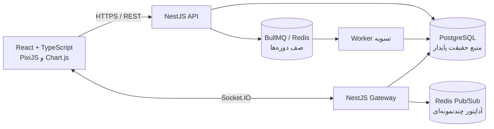

# معماری فنی نهایی «مسیر ثروت»

این سند معماری جاری کد را از تصمیم‌های لازم برای انتشار عملیاتی جدا می‌کند. بخش «وضعیت اجرا» توصیف واقعیت مخزن است؛ توصیه‌های انتشار، قابلیت‌هایی را که هنوز در محصول پیاده نشده‌اند صریحاً مشخص می‌کنند.

## ۱. نمای کلی

**قانون مالکیت داده:** PostgreSQL مرجع قطعی همهٔ دارایی‌ها، بدهی‌ها، تصمیم‌ها، دوره‌ها و دفترکل است. Redis پیام و کار زمان‌دار را جابه‌جا می‌کند؛ نتیجهٔ مالی فقط در تراکنش PostgreSQL ثبت می‌شود. مرورگر منبع حقیقت نیست.

## ۲. اجزای بک‌اند و مسئولیت‌ها

| ماژول | مسئولیت | داده/مرز تراکنش |
| --- | --- | --- |
| `RoomService` / `RoomController` | ساخت اتاق، عضویت، احراز توکن، تصمیم‌های بازیکن، ساختمان، وام، چک، قرارداد و Snapshot | هر اقدام تغییردهنده با `BEGIN/COMMIT/ROLLBACK` و قفل ردیف نوبت |
| `EconomyService` | شاخص‌ها، تورم، تسویهٔ حقوق، اجاره، کسب‌وکار، دارایی، وام، چک، بیمه و مزایده | یک تراکنش اتمیک برای هر اتاق-دوره؛ قفل advisory مختص اتاق |
| `TurnQueueService` | زمان‌بندی و بازیابی کار تسویه | BullMQ با شناسهٔ یکتای اتاق-دوره، retry نمایی و sweep بازیابی |
| `RoomGateway` / `RealtimeService` | ورود مجاز به کانال اتاق و انتشار رویداد برای به‌روزرسانی کلاینت‌ها | Socket.IO با آداپتور Redis؛ Snapshot مجدداً از PostgreSQL خوانده می‌شود |
| کلاینت PixiJS | نمایش شهر، انیمیشن، HUD، فرم‌ها و نمودار بازار | state موقت حافظه؛ فرمان‌ها از API می‌گذرند |

پروژه در حال حاضر NestJS است. الگوی داده SQL مستقیم با `pg` است و ORM/کلاس‌های Entity در کار نیست؛ جدول‌های PostgreSQL نقش مدل‌های Player، Business، Asset، Loan و Ledger را دارند.

## ۳. مدل پایدار PostgreSQL

- **بازیکن و اتاق:** `rooms`, `room_members`, `economy_accounts`, `room_turns`, `room_turn_ready`.
- **چرخهٔ اقتصاد:** `economic_periods`, `price_indices`, `player_decisions`, `economy_ledger`.
- **دارایی و شهر:** `investment_positions`, `city_buildings`, `fund_positions`, `player_auctions`, `player_auction_bids`.
- **کسب‌وکار:** `business_branches`, `business_owners`, `business_period_results`, `business_ledger`, پیشنهادهای شراکت.
- **اعتبار:** `loans`, `rent_arrears`, `checks`, `guarantees`, `guarantee_claims`, قراردادهای بازیکن.
- **پیشرفت:** `player_skills`, کارت/انتخاب رویداد، `insurance_policies`, `insurance_claims`, `player_challenges`, `wellbeing_scores`.

کلیدها و قیود مرکب اتاق-بازیکن مانع ارجاع بین اتاقی می‌شوند. مبلغ‌ها با `BIGINT` و رشتهٔ صحیح در مرز JSON حمل می‌شوند تا دقت ریاضی تومان از بین نرود. تاریخ دوره با کلید متنی سال-ماه شمسی مانند `1405-07` ذخیره می‌شود؛ timestampهای فنی سرور همچنان UTC هستند.

### دفترکل و سازگاری موجودی

هر رویداد پولی در `economy_ledger` شامل اتاق، دوره، حساب بازیکن، نوع و شناسهٔ منبع، تغییر وجه، موجودی پیش از تراکنش و موجودی پس از آن است. قید پایگاه داده تضمین می‌کند:

`balance_after_tomans = balance_before_tomans + amount_tomans`

دفترکل، journal افزایشی و حساب‌محور است؛ در این نسخه سامانهٔ حسابداری دوطرفهٔ کامل نیست. یکتایی منبع/دوره/حساب برای جلوگیری از ثبت دوبارهٔ رویدادهای تکراری به کار می‌رود. تغییرات دارایی نیز جدول موقعیت و در موارد قرارداد، دفتر قرارداد را به‌روز می‌کنند.

## ۴. تراکنش‌ها، قفل و تکرار امن

1. API توکن بازیکن را با SHA-256 مقایسه می‌کند و شناسهٔ بازیکن را از خود توکن نمی‌پذیرد.
2. عملیات دوره‌ای، ردیف `room_turns` را `FOR UPDATE` می‌خواند و وضعیت/مهلت/آمادگی بازیکن را اعتبارسنجی می‌کند.
3. تسویه با `pg_advisory_xact_lock(hashtext(roomId))` برای هر اتاق سری می‌شود؛ قفل تا پایان تراکنش آزاد نمی‌شود.
4. درج `economic_periods` و وضعیت `published` تسویه را idempotent می‌کند. اگر دوره پیش‌تر منتشر شده باشد، Worker همان دوره را دوباره اعمال نمی‌کند.
5. شکست در هر مرحله باعث rollback می‌شود؛ تغییر مانده، دفترکل، شاخص‌ها، نتایج شعب و انتشار دوره با هم commit می‌شوند.
6. Retry صف برای خرابی گذراست؛ idempotency پایگاه داده مرجع جلوگیری از اثر دوباره است.

## ۵. Redis، WebSocket و صف‌ها

### آنچه اجرا شده

- BullMQ صف `room-turns` را با jobId برابر `roomId_periodKey`، سه تلاش، backoff نمایی و تأخیر تا موعد نوبت اجرا می‌کند.
- در راه‌اندازی و هر ۶۰ ثانیه، نوبت‌های باز/در حال تسویه از PostgreSQL پیدا و در صف بازسازی می‌شوند؛ Redis تنها محل نگهداری برنامهٔ موعد نیست.
- Worker با concurrency چهار، `processDueTurn` را اجرا می‌کند.
- آداپتور Redis برای پخش Socket.IO میان نمونه‌های NestJS نصب می‌شود. رویدادها payload کوچکِ تغییر وضعیت‌اند؛ کلاینت برای اطلاعات مرجع Snapshot را می‌گیرد.
- قفل رقابت تسویه فعلاً در PostgreSQL است، نه Redis. Redis در این پیاده‌سازی cache وضعیت کامل اتاق نیست.

### گسترش مقیاس

- برای چند Worker، concurrency و تعداد workerها با ظرفیت pool پایگاه داده تنظیم شود؛ advisory lock همچنان تسویهٔ دوگانهٔ همان اتاق را مهار می‌کند.
- صف‌های مستقل و محدودیت نرخ برای ایمیل/اعلان یا پردازش سنگین جدا شوند؛ تسویهٔ پولی در صف مشترکِ پردازش‌های غیرضروری قرار نگیرد.
- پایش: عمق صف، قدیمی‌ترین job، شمار retry/fail، زمان تسویه، تأخیر رویداد WebSocket، تعداد reconnect و سلامت اتصال PostgreSQL/Redis.

## ۶. امنیت

### کنترل‌های موجود

- توکن اتاق تصادفی با ۳۲ بایت entropy تولید می‌شود؛ hash آن ذخیره می‌شود. توکن خام فقط هنگام ساخت/ورود برگردانده می‌شود.
- REST و Socket عضویت را با roomId و توکن بررسی می‌کنند. خطای ورود Socket اطلاعات دسترسی را فاش نمی‌کند.
- مقادیر SQL با پارامتر bind می‌شوند؛ نام‌های ستون پویا فقط از فهرست ثابت مهارت‌ها انتخاب می‌شوند.
- `.env.example` فقط مقادیر محلی توسعه دارد؛ اسرار محیط واقعی نباید در مخزن ثبت شوند.

### الزامات پیش از انتشار

- TLS اجباری، `CORS_ORIGIN` محدود به دامنه‌های واقعی و fail-fast در محیط production؛ در حال حاضر CORS HTTP فقط در صورت وجود متغیر فعال می‌شود.
- محدودیت نرخ و سقف بدنه برای ساخت/ورود اتاق، REST و پیام چت؛ محدودیت اتصال هم‌زمان و بررسی اندازهٔ پیام WebSocket.
- سیاست CSP، جلوگیری از XSS، اعتبارسنجی schema ورودی‌ها، log پالایش‌شده بدون توکن/نام محرمانه، rotation و ابطال توکن نشست.
- دسترسی شبکهٔ PostgreSQL و Redis خصوصی، رمز عبور/ACL، TLS بین سرویس‌ها در محیط توزیع‌شده، backup رمزگذاری‌شده و آزمون بازیابی.
- توکن فعلی مرورگر در `sessionStorage` و به‌شکل رمزنگاری‌نشده نگهداری می‌شود. پیش از انتشار عمومی، ترجیح با نشست کوتاه‌عمر در کوکی `HttpOnly; Secure; SameSite` و محافظت CSRF است؛ اگر bearer token حفظ شود، عمر کوتاه، CSP سخت‌گیرانه و عدم ذخیرهٔ دائمی الزامی است.

## ۷. دادهٔ محلی و همگام‌سازی آفلاین

### رفتار فعلی

- Snapshot مالی فقط در حافظهٔ React است و پس از reconnect از سرور دوباره خوانده می‌شود.
- اطلاعات نشست در `sessionStorage` است؛ تنظیم کاهش حرکت و آخرین دورهٔ دیده‌شده در `localStorage` هستند.
- outbox آفلاین برای عملیات وجود ندارد. اگر شبکه قطع باشد، درخواست تغییر وضعیت خطا می‌دهد؛ کاربر نباید تصور کند خرید/وام/ساخت ثبت شده است.

### الگوی امن برای قابلیت آفلاین آینده

1. برای نمایش آفلاین، فقط Snapshot محدود و با عمر مشخص در IndexedDB cache شود؛ دادهٔ مالی حساس با AES-GCM رمز شود و کلید WebCrypto غیرقابل‌استخراج و محدود به نشست باشد. هنگام logout، کلید و cache پاک شوند. رمزنگاری مرورگر خطر XSS را حذف نمی‌کند.
2. Outbox فقط intentهای مجاز را نگه دارد؛ هر intent شامل `clientOperationId` تصادفی، roomId، playerId، periodKey، نوع عمل، payload حداقلی، زمان ایجاد و شمارهٔ ترتیب باشد.
3. در اتصال مجدد، ابتدا Snapshot تازه و وضعیت نوبت از سرور گرفته شود؛ سپس intentها به ترتیب ارسال شوند. سرور کلید تکرار را ثبت و عملیات را با موجودی و وضعیت جاری دوباره اعتبارسنجی کند.
4. intent منقضی‌شده، دورهٔ قفل‌شده، موجودی ناکافی یا تعارض با Snapshot تازه با وضعیت «نیازمند تصمیم بازیکن» برگردد؛ کلاینت آن را خودکار به خرید/فروش دیگری تبدیل نکند.
5. پیش‌نویس سفارش نوبت را می‌توان آفلاین نگه داشت؛ وام، چک، ضمانت، قرارداد، خرید ساختمان، مزایده و پذیرش تعهد مالی تا تأیید آنلاین نباید به‌عنوان عملیات موفق نمایش داده شوند.
6. سرور پس از پاسخ قطعی، outbox را حذف کند؛ timeout مبهم با همان `clientOperationId` دوباره ارسال شود تا پاسخ نتیجهٔ قبلی بازیابی شود.

این الگو هنوز پیاده‌سازی نشده است؛ تا آن زمان همگام‌سازی reconnect فقط Snapshot و رویدادهای زنده را بازیابی می‌کند و عملیات نوشته‌شده در حالت قطع شبکه ماندگار نیست.

## ۸. استقرار و تنظیم محیط

متغیرهای الزامی: `DATABASE_URL`, `REDIS_URL`, `PORT`, `CORS_ORIGIN`. مهاجرت با `npm run migrate` اجرا می‌شود. `docker-compose.yml` برای توسعه PostgreSQL 17 و Redis 7.4 را بالا می‌آورد؛ مقدارهای پیش‌فرض compose فقط محلی‌اند و برای production باید با secret manager جایگزین شوند.

چرخهٔ راه‌اندازی پیشنهادی: آماده‌سازی secretها ← بررسی سلامت PostgreSQL/Redis ← اجرای migration یک‌بار ← بالا آوردن NestJS و Worker ← health-check و مانیتور صف ← پشتیبان‌گیری و آزمون restore. مقیاس‌دادن API و worker مستقل ممکن است؛ همهٔ replicaها باید به یک پایگاه مشترک و Redis مشترک با ACL متصل باشند.

## ۹. معیار پذیرش معماری

- تسویهٔ تکراری یا هم‌زمان موجودی و ledger را دوبار تغییر ندهد.
- جمع `موجودی پیش + تغییر` برای هر ردیف ledger دقیقاً موجودی پس باشد.
- قطع Redis باعث گم‌شدن موعدها نشود؛ بازیابی از PostgreSQL ممکن باشد.
- قطع WebSocket باعث از دست‌رفتن دادهٔ قطعی نشود؛ reconnect با Snapshot مرجع همگام شود.
- توکن، رمز عبور و رشتهٔ اتصال در log یا storage دائمی افشا نشوند.
- عملیات مالی آفلاین تا تأیید سرور «ثبت‌شده» اعلام نشوند.
